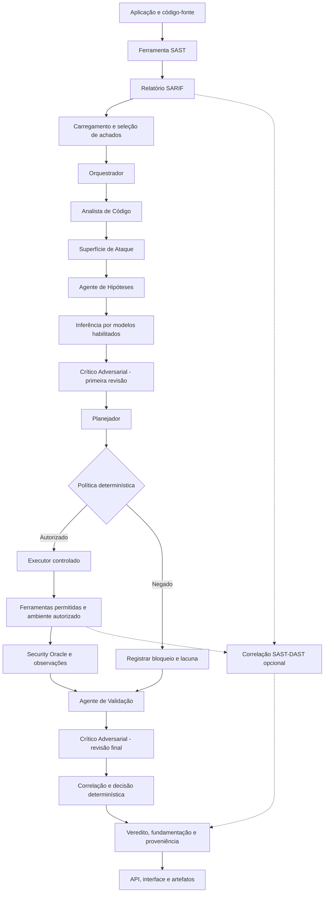
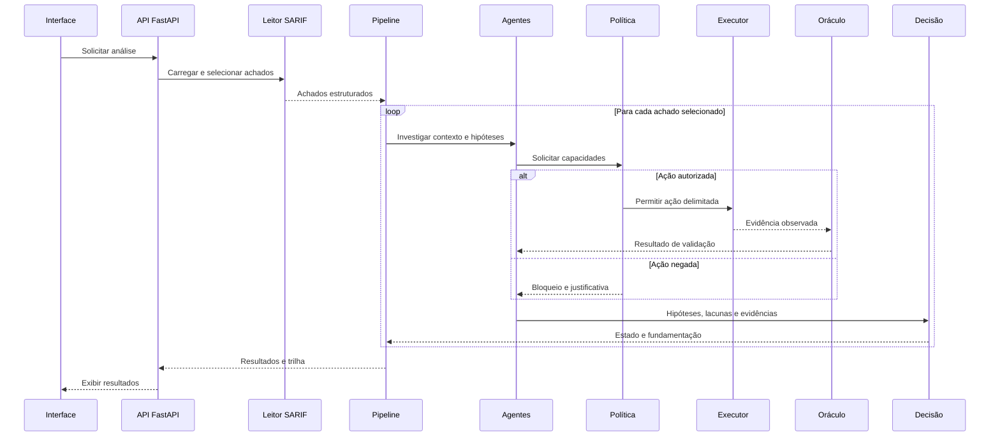
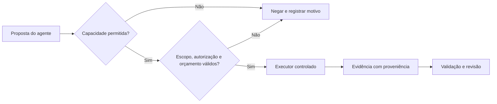

# VeritasSec-Agent — Arquitetura multiagente, execução e evidências

> **Escopo e proveniência.** Este documento é exclusivo do repositório **VeritasSec-Agent**, independente do README do projeto VeritasSec. Documenta a evolução do **VeritasSec-Agent** com base em registros de projeto, saídas de testes e contratos de código compartilhados até 07/11/2026. Não se deve presumir que as instruções do repositório VeritasSec original sejam operacionais no VeritasSec-Agent. O código local em execução é a autoridade para parâmetros e configurações. Esta edição inclui inspeção direta dos arquivos presentes no pacote de código `projeto(1).zip` de 02/11/2026; o ambiente local pode ter alterações posteriores.

## 1. Identidade, objetivo e contribuição científica

O VeritasSec-Agent é uma evolução experimental do VeritasSec para investigar **agência verificável na aquisição de evidências** de segurança. O alerta SAST é tratado inicialmente como uma **hipótese**, não como comprovação de vulnerabilidade. Os agentes devem formular explicações causais, identificar lacunas, solicitar verificações e submeter propostas a uma política determinística antes de qualquer ação.

A contribuição pretendida é uma trilha **hipótese → plano → autorização → execução controlada → evidência → validação → decisão auditável**. A melhoria de precisão, recall ou F1 não é presumida pela existência de sete agentes: precisa ser demonstrada em avaliação comparativa reproduzível.

### 1.1 Princípios arquiteturais

| Princípio | Consequência operacional |
|---|---|
| Achado como hipótese | Um alerta SAST isolado não confirma exploração. |
| Separação entre IA e autorização | LLM sugere; política determinística permite ou nega. |
| Execução restrita | Executor só usa capacidades autorizadas, escopo e orçamento definidos. |
| Falha segura | Ausência de evidência suficiente não se converte automaticamente em VP ou FP. |
| Proveniência | Evidência deve ser vinculável a origem, entrada e execução. |
| Crítica adversarial | Hipóteses são contestadas antes e depois da validação. |
| Auditabilidade | Preservar trilha, decisões, lacunas, critérios de parada e limitações. |

## 2. Arquitetura lógica completa



**Importante:** o desenho acima representa a arquitetura funcional registrada, e não um rastreamento de todas as chamadas da versão local atual. A correlação SAST–DAST é um enriquecimento opcional e não equivale, por si só, a uma confirmação de exploração.

### 2.1 Componentes e limites de confiança

| Camada | Elementos conhecidos | Limite de confiança |
|---|---|---|
| Entrada | SARIF, código-fonte, parâmetros da requisição | Tratar conteúdo como não confiável; validar escopo e formato. |
| Contextualização | Leitor SARIF, seleção, contexto estático | Preservar identificadores, caminhos e trechos necessários. |
| Cognição | Sete papéis Agno; provedores LLM | Saídas de LLM são propostas e interpretações, não autorizações. |
| Controle | Política determinística, orçamento, lista de capacidades | Somente capacidades autorizadas podem alcançar o executor. |
| Observação | Ferramentas locais, validadores, ZAP autorizado | Evidência observada deve ser diferenciada de inferência. |
| Decisão | Validação, crítica e correlação determinística | Decisão deve respeitar evidência e regras de parada. |
| Exposição | FastAPI, interface, relatórios, banco | Sanitizar segredos e distinguir estado de execução de resultado. |

## 3. Os sete agentes: responsabilidades e interação

Os identificadores abaixo foram registrados em verificações de identidade dos **sete agentes Agno**. Provedores Local, GPT e Gemini **não são agentes adicionais**.

| Ordem lógica | Identificador | Papel | Entrada típica | Produto esperado |
|---:|---|---|---|---|
| 1 | `orquestrador` | Coordenar investigação e escopo | Achado, política, parâmetros | Sequência e trilha de investigação |
| 2 | `analista_codigo` | Adquirir e interpretar contexto estático | Arquivo, linha, regra, código | Contexto e indícios técnicos |
| 3 | `superficie_ataque` | Relacionar código com exposição e entradas | Contexto estático | Condições de alcance e exposição |
| 4 | `hipoteses` | Formular hipóteses verificáveis | Indícios e contexto | Hipóteses, lacunas e possíveis verificações |
| 5 | `planejador` | Propor aquisição de evidências | Hipóteses sobreviventes, limites | Plano de ações submetido à política |
| 6 | `validacao` | Interpretar resultados observados | Evidências e resultados do oráculo | Avaliação de suporte/refutação |
| 7 | `critico_adversarial` | Contestar hipóteses e decisão | Hipóteses, evidências e lacunas | Revisões críticas em dois momentos |

### 3.1 Orquestrador (`orquestrador`)

1. Recebe o achado selecionado e o contexto operacional.
2. Inicia investigação no escopo fornecido.
3. Coordena os papéis e a trilha de eventos.
4. Encaminha propostas à política de capacidades, quando necessário.
5. Preserva o estado da investigação para consolidação.

**Evidência histórica:** em um canário controlado, a trilha registrou a decisão de iniciar investigação sem ampliar automaticamente o alvo.

### 3.2 Analista de Código (`analista_codigo`)

1. Identifica arquivo, localização e regra associados ao achado.
2. Solicita leitura ou busca de código por capacidade permitida.
3. Adquire contexto estático do trecho suspeito.
4. Produz observações que serão usadas na investigação.

**Evidência histórica:** a capacidade `busca_codigo` foi registrada como executada no teste controlado.

### 3.3 Superfície de Ataque (`superficie_ataque`)

1. Recebe o contexto do código.
2. Examina caminhos de entrada e condições de exposição.
3. Relaciona os indícios com possíveis pré-condições de exploração.
4. Solicita capacidades complementares, sujeitas à política.

**Atenção:** uma ferramenta solicitada pelo agente pode ser negada. Solicitação não significa execução.

### 3.4 Hipóteses (`hipoteses`)

1. Converte indícios em hipóteses causais verificáveis.
2. Identifica quais fatos apoiam e quais enfraquecem cada hipótese.
3. Registra lacunas de evidência.
4. Propõe verificações que possam reduzir incerteza.

O modelo de linguagem pode auxiliar nessa formulação, mas a resposta textual não é prova de exploração.

### 3.5 Crítico Adversarial (`critico_adversarial`)

**Primeira revisão:** confronta hipóteses com o contexto disponível, identifica pressupostos frágeis e encaminha hipóteses sobreviventes/lacunas ao planejamento.

**Segunda revisão:** confronta hipóteses com evidências adquiridas, observações do oráculo e resultados da validação, registrando contradições remanescentes.

Trata-se de **um único papel**, empregado em dois momentos da arquitetura; não há oitavo agente.

### 3.6 Planejador (`planejador`)

1. Recebe hipóteses e lacunas.
2. Propõe ações de aquisição de evidência.
3. Considera ganho de informação, custo, risco e orçamento.
4. Submete propostas à política determinística.
5. Registra bloqueios e, quando permitido, replaneja.

Em registros históricos, houve replanejamento sem nova ação autorizada com ganho de informação; isso deve ser interpretado como limite de evidência, não falha automática de LLM.

### 3.7 Validação (`validacao`)

1. Recebe evidências efetivamente produzidas e condições testadas.
2. Verifica se observações sustentam, contradizem ou não resolvem a hipótese.
3. Considera os resultados do Security Oracle, quando aplicável.
4. Encaminha sua avaliação à revisão adversarial final e à correlação.

### 3.8 Distinção entre papel, execução e inferência

| Indicador | O que comprova | O que não comprova |
|---|---|---|
| Sete papéis cadastrados | Estrutura declarada | Sete chamadas ao provedor |
| Sete objetos Agno | Instanciação | Sete respostas LLM válidas |
| `agentes_executados` com sete nomes | Passagem registrada na trilha | Inferência remota em todos os papéis |
| `agent.run` com saída tipada | Contrato de invocação | Qualidade científica da resposta |
| Teste automatizado aprovado | Comportamento do cenário testado | Ganho de precisão no conjunto experimental |

## 4. Pipeline passo a passo



**Nota:** a ordem de chamadas efetivas pode depender de modo, parâmetros, políticas, erros e implementações posteriores. O diagrama expressa o fluxo de referência, não uma captura dinâmica de execução atual.

### 4.1 Seleção individual e múltiplos achados

O contrato previamente inspecionado de `executar_pipeline_sarif_agent` aceita `sarif_path`, `projeto_path`, `indice`, `achado_id` e `limite`. Sem `indice`/`achado_id`, o fluxo base prevê processamento multi-achado; com seleção explícita, prevê processamento individual. A resposta histórica inclui `modo`, `total_achados_sarif`, `total_selecionado`, `total_processado` e, conforme o caso, `resultado` ou `resultados`.

**Contrato importante da interface:** o backend histórico utiliza `modo`, enquanto um renderizador antigo verificava `processamento`. A correção da interface em 02/11/2026 teve regressão de 47 testes aprovada; não se deve inferir que toda renderização de produção foi validada ponta a ponta.

### 4.2 Contexto analítico e contextual

| Modo | Característica | Risco metodológico |
|---|---|---|
| Contextual | Inclui linhas de código e contexto relacionado | Truncamento ou contexto incompleto |
| Analítico | Pode operar com `linhas_contexto=0` | Menor evidência local de fluxo de dados |

A comparação entre modos deve manter fixos conjunto de achados, modelo, versão, parâmetros, rótulos de referência e critérios de exclusão.

## 5. Modelos LLM e integração cognitiva

Registros anteriores citam suporte a Gemini, OpenAI e execução local/Ollama, com `gemini-2.5-flash` como modelo ativo em parte das avaliações. A disponibilidade real depende de credenciais, configuração, cotas e ambiente. O suporte a um provedor **não comprova** que uma chamada remota tenha ocorrido numa execução específica.

### 5.1 Limites de autoridade dos LLMs

Os LLMs podem interpretar código, formular hipóteses, sugerir verificações e auxiliar a fundamentação. Não devem, por decisão própria, liberar execução dinâmica, alterar política, executar shell arbitrário, bloquear CI/CD ou definir sozinhos a segurança final.

### 5.2 Saída tipada e tratamento de falhas

Há registro histórico de integração Agno com `agent.run(..., output_schema=DecisaoAgenteLLM)` e de ferramentas não anexadas diretamente aos agentes. Isso indica intenção de obter decisões estruturadas. Não substitui a verificação de validação de esquema, timeout, retentativas, respostas vazias e tratamento de indisponibilidade na versão em execução.

## 6. Política determinística, executor e aquisição de evidências



Registros de execução mostram motivos como `CAPACIDADE_FORA_DA_ALLOWLIST`, evidenciando que a política pode recusar ações solicitadas pelos agentes. Foram registrados controles cognitivos M20 e aquisição M21B com cadeia **decisão → política → executor → evidência** aprovada em testes. O comportamento de falha segura exige que ausência de autorização ou de evidência seja preservada na decisão.

### 6.1 Orçamento e critérios de parada

Os artefatos históricos registram campos como `max_acoes`, `acoes_executadas`, `max_iteracoes`, `criterio_parada` e `motivo_termino`. Um exemplo de critério observado é `PLANO_CONCLUIDO`. Esses campos devem ser expostos como **valores da execução**, não números fixos no README.

## 7. Security Oracle, estados e vereditos

O Security Oracle atua como mecanismo de observação/validação das condições testadas. O resultado deve distinguir:

| Estado ou conceito | Interpretação cuidadosa |
|---|---|
| Verdadeiro positivo (VP/TP) | Evidências suficientes segundo a regra aplicável. |
| Falso positivo (FP) | Refutação sustentada pelas condições e limites testados. |
| Inconclusivo | Não foi possível sustentar nem refutar adequadamente. |
| Evidência dinâmica | Observação produzida por execução autorizada. |
| Alerta DAST | Sinal de scanner; não é automaticamente prova de exploração. |
| Correlação semântica | Vínculo inferido por atributos; não substitui oráculo. |

**Atenção:** o mecanismo preciso de decisão deve ser auditado por versão; não atribuir votação simples ou ponderação entre LLMs sem evidência do código.

## 8. Integração DAST com OWASP ZAP

O ambiente local registrado utiliza ZAP 2.17.0 em contêiner `veritassec-zap-local`, publicado em loopback na porta 8090, e OWASP Juice Shop em `veritassec-juice-shop-local`, com porta 3001 no host. Esses são **dados históricos de ambiente**, não instruções para recriar ou modificar contêineres já aprovados.

### 8.1 Caminho condicional no pipeline

No contrato inspecionado de `pipeline_agent.py`, a integração de enriquecimento DAST é condicionada a `VERITASSEC_DAST_INTEGRAR` com valores `1`, `true` ou `sim`. A função `enriquecer_resultado_sarif` é chamada após a execução base quando a condição está habilitada. A execução DAST não deve ser presumida quando a opção estiver desativada.

### 8.2 Correlação SAST–DAST

Os módulos identificados incluem:

- `aplicacao/multiagente/integracao_dast_pipeline.py` — enriquecimento da resposta.
- `aplicacao/multiagente/execucao_dast_controlada.py` — execução DAST controlada.
- `aplicacao/multiagente/correlacao_sast_dast.py` — correlação original.
- `aplicacao/multiagente/correlacao_semantica_http.py` — correspondência semântica HTTP.
- `aplicacao/multiagente/integracao_semantica_dast.py` — integração da correlação semântica.
- `aplicacao/multiagente/pipeline_agent.py` — contrato do pipeline SARIF.

A correlação utiliza atributos disponíveis como origem, caminho/endpoint, método, parâmetro e CWE. Quando faltam elementos para vincular um alerta dinâmico a um achado estático, o resultado deve permanecer **não determinado**.

| Estado da correlação | Significado | Não significa |
|---|---|---|
| `CONFIRMADA` | Correspondência sustentada pelos critérios do correlacionador | Exploração necessariamente comprovada |
| `POSSIVEL` | Compatibilidade parcial | VP confirmado |
| `NAO_DETERMINADA` | Evidência insuficiente para vínculo | FP ou ausência de vulnerabilidade |

### 8.3 Caso real registrado

| Medida | Valor registrado |
|---|---:|
| Achados SARIF do Juice Shop | 36 |
| Alertas ZAP consultados | 3 |
| Correspondências confirmadas | 0 |
| Correspondências possíveis | 0 |
| Correspondências não determinadas | 36 |
| Regressão de integração | 47 testes aprovados |

Esses valores correspondem a um cenário histórico e **não** representam métricas gerais de classificação do sistema. A validação de integração não reexecutou integralmente todos os LLMs.

## 9. API, interface e contratos

### 9.1 Rotas identificadas em registros anteriores

| Rota | Uso documentado | Observação |
|---|---|---|
| `POST /api/interface/analisar` | Análise pela interface | Rota operacional registrada |
| `/api/v1/multiagente/investigar` | Investigação multiagente | Contrato completo deve ser consultado no código |
| `/interface` | Interface web | Acessada historicamente em `127.0.0.1:8083` |

A interface foi organizada em seções de configuração, análise, resultados, evidências, gráficos e VeritasSec-Agent. O painel cognitivo utiliza contratos específicos de renderização, que devem distinguir total de achados no SARIF, selecionados, processados e resultados operacionais efetivamente retornados.

### 9.2 Contrato de resposta SARIF

```json
{
  "modo": "multiachado",
  "total_achados_sarif": 36,
  "total_selecionado": 2,
  "total_processado": 2,
  "resultados": []
}
```

**Exemplo estrutural ilustrativo, não resposta real:** os contadores representam campos do contrato histórico; o array vazio acima não deve ser interpretado como execução concluída com dois resultados. Em execução real, os itens retornados precisam ser consistentes com `total_processado`.

### 9.3 Evidências visuais versus execução cognitiva

Um gráfico com 36 achados pode representar resultados de outra etapa do pipeline. Não comprova que a execução cognitiva tenha processado 36 achados. A interface deve manter rastreabilidade entre requisição, trabalho, resposta e renderizador.

## 10. Estrutura de diretórios e módulos conhecidos

```text
VeritasSec-Agent/
├── aplicacao/
│   ├── ui/
│   │   └── interface_agent.py
│   └── multiagente/
│       ├── pipeline_agent.py
│       ├── orquestrador.py
│       ├── sarif_agent.py
│       ├── fundamentacao.py
│       ├── integracao_dast_pipeline.py
│       ├── execucao_dast_controlada.py
│       ├── correlacao_sast_dast.py
│       ├── correlacao_semantica_http.py
│       └── integracao_semantica_dast.py
├── input/
│   ├── sarif/
│   └── projects/
├── tests/
└── .venv/
```

A árvore acima é um resumo arquitetural. O inventário exaustivo dos arquivos Python presentes no pacote `projeto(1).zip` está no Anexo A, gerado por inspeção estática direta.

### 10.1 Diretórios operacionais históricos

| Local | Finalidade |
|---|---|
| `~/Documentos/Projetos/VeritasSec-Agent` | Código do projeto |
| `~/Documentos/Projetos/VeritasSec-Agent-Saidas` | Resultados e evidências |
| `.venv/bin/python` | Interpretador do ambiente virtual |
| `input/sarif/` | Relatórios SARIF |
| `input/projects/` | Código dos projetos analisados |
| `tests/` | Testes automatizados |

Evite registrar caminhos pessoais absolutos, credenciais, chaves, IPs internos e nomes de máquinas em evidências publicadas.

## 11. Instalação e execução: orientações seguras

A README do VeritasSec original documenta uma configuração anterior do VeritasSec. Para a revisão multiagente atual, **não executar comandos de instalação, criação de banco ou `docker compose up` sem conferir o arquivo de configuração e o ambiente**. Os contêineres ZAP e Juice Shop anteriormente aprovados não devem ser recriados apenas para gerar documentação.

### 11.1 Inspeção local sem alterações

```bash
cd "$HOME/Documentos/Projetos/VeritasSec-Agent" || exit 1
[ -x .venv/bin/python ] && .venv/bin/python --version
[ -d tests ] && find tests -maxdepth 1 -type f -name 'test_*.py' | wc -l
[ -f README.md ] && wc -l README.md
```

Esses comandos não iniciam serviços, não consultam LLMs e não alteram o projeto.

### 11.2 Execução da interface

A interface local foi registrada em `http://127.0.0.1:8083/interface`. O script de inicialização citado no histórico é `scripts/subir-veritassec-interface.sh`. Antes de executar, conferir seu conteúdo, permissões, variáveis de ambiente e se já há processo em execução. Não há comprovação nesta documentação de que o mesmo comando ou porta esteja válido em qualquer instalação.

### 11.3 Configurações e credenciais

| Configuração conhecida | Papel | Observação |
|---|---|---|
| `VERITASSEC_DAST_INTEGRAR` | Habilitar enriquecimento DAST | Condição documentada: `1`, `true` ou `sim` |
| `USAR_GEMINI` | Habilitação de provedor | Flag citada em configuração histórica |
| `USAR_OPENAI` | Habilitação de provedor | Flag citada em configuração histórica |
| `USAR_OLLAMA` | Habilitação de provedor local | Flag citada em configuração histórica |
| Chave de API do provedor | Autenticação | Não versionar nem exibir em logs |
| Chave da API ZAP | Autenticação local | Não registrar em URL, print ou artefato público |

O nome exato das demais variáveis e seus padrões deve ser confirmado nos arquivos de configuração da revisão instalada; **não reutilizar automaticamente valores antigos**.

## 12. Persistência e artefatos

O projeto possui histórico de uso de PostgreSQL e tabelas como `execucoes`, `dataset_analise`, `avaliacoes_modelos`, `metricas_provedores`, `artefatos_execucao`, `base_conhecimento_vetorial` e `achados_complementares`. A README do VeritasSec original documenta esquema de uma versão anterior; **não executar DDL antigo como migração da versão atual** sem validação do esquema efetivo.

Os artefatos de execução podem incluir JSON, CSV, Markdown, gráficos e trilhas de evidência. Um resultado auditável deve associar achado, versão do código, entrada SARIF, parâmetros, provedores, decisões, autorizações, evidências, estados e hashes quando disponíveis.

## 13. Testes, regressões e evidências históricas

| Marco | Evidência registrada | Limite da evidência |
|---|---|---|
| M17D | Sete agentes Agno, `agent.run` integrado, saída tipada | Não prova ganho de desempenho |
| M19E | Processamento multi-achado e HTTP 200 com dois achados | Cenário específico, não todos os achados |
| M20 | Controle cognitivo e negativas de execução insegura | Testes de política, não exploração real universal |
| M21B | Decisão → política → executor → evidência | Cenários cobertos pelos testes |
| M22C | Interface operacional, clone de resposta, contadores | Contratos testados na época |
| Canário CWE-22 | Sete agentes e evidência dinâmica controlada | Não generalizar para outras CWEs |
| Integração DAST (nov/2026) | 36 SARIF, 3 alertas, 47 testes | Correlação sem vínculo, sem inferência LLM completa |
| Correção de interface (nov/2026) | 47 testes aprovados | Não equivale a validação visual integral |

### 13.1 Auditoria estática de novembro de 2026

Um resumo de auditoria registrado em 01/11/2026 apontou **160 módulos, 544 funções, 5.225 chamadas, 699 imports, 201 arestas internas, 8 rotas, 310 testes e 18 achados de auditoria**. Essas contagens refletem uma coleta estática e não devem ser confundidas com resultados de execução, testes aprovados ou vulnerabilidades confirmadas. A análise AST não resolve integralmente despacho dinâmico ou decoradores complexos.

### 13.2 Diferença entre testes

- **Unitário:** verifica comportamento isolado e pode usar simulações.
- **Integração:** verifica contrato entre componentes, possivelmente com dependências simuladas.
- **Ponta a ponta controlado:** percorre uma cadeia definida, sem necessariamente representar produção.
- **Execução real de LLM:** requer registro de chamada, modelo, parâmetros, resposta e custo/latência quando disponível.
- **Avaliação científica:** requer rótulos de referência, protocolo pareado e métricas reproduzíveis.

## 14. Resultados observados e avaliação experimental

Esta seção apresenta **resultados efetivamente exibidos na interface do VeritasSec-Agent** nas capturas fornecidas, preservando a distinção entre **classificação produzida pela aplicação**, **origem dos dados**, **execução de componentes** e **métricas de desempenho contra rótulos de referência**. Os percentuais a seguir são distribuições de vereditos, **não** precisão, revocação, especificidade ou acurácia.

### 14.1 Resultados das execuções exibidas

| Indicador apresentado | Captura de 01/11/2026 | Capturas de 02/11/2026 |
|---|---:|---:|
| Achados apresentados | 36 | 36 |
| `VERDADEIRO_POSITIVO` | 11 (30,6%) | 8 (22,2%) |
| `INCONCLUSIVO` | 25 (69,4%) | 28 (77,8%) |
| `FALSO_POSITIVO` exibidos no gráfico | 0 | 0 |
| Outras categorias de classificação exibidas | Nenhuma | Nenhuma |

**Cálculo dos quantitativos:** 30,6% de 36 corresponde a 11 achados (11/36 = 30,56%); 69,4% corresponde a 25; 22,2% corresponde a 8; 77,8% corresponde a 28. Os valores são obtidos dos totais e percentuais apresentados nos gráficos, com arredondamento a uma casa decimal. As capturas de 28/10/2026 também exibem a distribuição 11/25; não representam, por si sós, uma terceira população experimental independente.

**Interpretação:** houve diferença na distribuição dos vereditos apresentados entre as capturas. As imagens, isoladamente, **não identificam a causa** da diferença nem permitem afirmar se foram usadas as mesmas configurações, o mesmo código, as mesmas respostas de modelo ou a mesma execução. Não atribuir a mudança a ganho ou perda de eficácia sem comparação pareada dos registros por identificador de achado.

### 14.2 Origem e cobertura exibidas no painel

Nas capturas completas do painel de gráficos aparecem os seguintes contadores:

| Dimensão do painel | Valor exibido |
|---|---:|
| Análise estática | 36 |
| Análise dinâmica | 0 |
| Oracle | 0 |
| ZAP | 0 |
| Gemini | 36 |
| Modelo local | 0 |
| GPT | 0 |
| Campo de classificação/agrupamento auxiliar `N/A` | 36 (100%) |

**Limite de interpretação:** esses são **contadores da interface**. A indicação `Gemini = 36` não comprova, sem logs, 36 chamadas remotas bem-sucedidas ou 36 respostas distintas do modelo. Analogamente, `ZAP = 0`, `Oracle = 0` e `Dinâmica = 0` não demonstram a inexistência desses componentes no projeto; indicam ausência de contabilização nessas categorias **na visualização apresentada**. O significado técnico do campo `N/A` depende do contrato do gráfico, que não é identificável apenas pela imagem.

### 14.3 Distribuição por regra SAST

O gráfico de regras apresenta categorias como `javascript.sequelize` (6), `javascript.express.s` (4), `generic.secrets.secu` (3), `html.security.audit.` (3), `javascript.audit.det` (2), várias regras `javascript.lang.secu` (2 cada), `javascript.browsers` (2) e `yaml.github-actions.` (1). Os rótulos aparecem **truncados na interface** e, portanto, **não devem ser usados como identificadores canônicos** de regras SARIF sem conferir o arquivo original. Não inferir a distribuição completa dos 36 achados a partir das barras visíveis.

### 14.4 O que os resultados comprovam e o que ainda não comprovam

**Comprovado pelas capturas:** o painel do VeritasSec-Agent exibiu 36 achados e distribuições de 11 VP/25 inconclusivos e, posteriormente, 8 VP/28 inconclusivos; a visualização contabilizou 36 na categoria estática e 36 na categoria Gemini, com zero nas demais categorias listadas.

**Não comprovado somente pelas capturas:** correspondência dos 36 achados com rótulos de referência independentes; matriz de confusão; precisão, revocação, especificidade, F1; taxa de falsos positivos corrigidos; superioridade sobre LLM individual; execução efetiva dos sete agentes por achado; quantidade de chamadas reais ao Gemini; causa da alteração dos vereditos; confirmação de exploração pelo ZAP.

A categoria `VERDADEIRO_POSITIVO` é **o veredito mostrado pelo sistema**, não um rótulo de referência validado externamente. `INCONCLUSIVO` não equivale a `FALSO_POSITIVO` nem a erro de classificação sem regra experimental explícita.

### 14.5 Protocolo para métricas de classificação

Para calcular métricas científicas, associar **cada** resultado ao identificador estável do achado, rótulo de referência, versão do código, configuração, modelo, contexto, trilha de agentes e evidências. A população e a política de tratamento de inconclusivos devem ser fixadas **antes** do cálculo. Comparações entre LLM isolado, multiagente e multiagente com evidência dinâmica exigem observações pareadas por achado.

| Métrica | Requisito para cálculo válido |
|---|---|
| Precisão | VP e FP definidos contra referência independente |
| Revocação | VP e FN definidos contra referência independente |
| Especificidade | VN e FP definidos contra referência independente |
| F1 | Precisão e revocação sobre a mesma população |
| McNemar | Resultados corretos/incorretos pareados por achado e hipótese definida |
| Cobertura | Denominador e tratamento de inconclusivos explícitos |

### 14.6 Evidências visuais utilizadas

- `Captura de tela de 2026-10-28 19-18-59.png`, `20-00-58.png` e `21-57-10.png`: distribuição de 36 achados com 30,6% VP e 69,4% inconclusivos.
- `Captura de tela de 2026-11-01 16-42-13.png`: painel completo, mesma distribuição 30,6%/69,4%, além dos contadores por origem e provedor.
- `Captura de tela de 2026-11-02 18-02-30.png` e `18-26-25.png`: distribuição de 36 achados com 22,2% VP e 77,8% inconclusivos.

**Proveniência:** capturas de tela fornecidas pelo autor do projeto. Este README não afirma ter extraído registros de banco de dados ou arquivos JSON dessas execuções.

## 15. Segurança, privacidade e governança

- Nunca versionar credenciais, tokens, chaves do ZAP ou respostas que as contenham.
- Restringir testes dinâmicos a alvos explicitamente autorizados.
- Não permitir que texto de LLM altere escopo, política ou autorização.
- Preservar registros de capacidades negadas e justificativas.
- Não transformar ausência de alertas em prova de segurança.
- Distinguir evidência observada, inferência e decisão.
- Anonimizar nomes pessoais, caminhos locais, hostnames, IPs internos e URLs restritas antes de publicar.
- Preservar backup e rollback antes de qualquer intervenção no código.
- Não executar `git add`, `commit` ou `push` sem autorização explícita.

## 16. Roteiro de demonstração para orientador e avaliadores

| Tempo aproximado | Demonstração | Evidência esperada |
|---|---|---|
| 0–3 min | Problema científico e arquitetura | Diagrama e hipótese de pesquisa |
| 3–5 min | Entrada SARIF e seleção | Achado original e rótulo |
| 5–9 min | Sete agentes e suas entradas | Trilha, prompts e respostas disponíveis |
| 9–12 min | Hipóteses e crítica adversarial | Lacunas e decisões intermediárias |
| 12–15 min | Planejamento, política e execução | Autorizações, negativas e evidências |
| 15–17 min | Oráculo, validação e decisão | Regra final e justificativa |
| 17–19 min | Comparação experimental | Métricas e divergência real |
| 19–20 min | Limitações e próximos testes | Pendências claramente identificadas |

## 17. Limitações e pendências de verificação

1. Este arquivo foi consolidado a partir de um README anterior e evidências históricas, **sem acesso direto ao estado atual completo do repositório local**.
2. A lista de módulos é representativa, não exaustiva; auditoria estática histórica indicou 160 módulos.
3. Os textos completos dos prompts, parâmetros dos modelos e todas as regras de decisão atuais não foram recuperados integralmente.
4. O registro de sete papéis não significa sete inferências remotas em toda execução.
5. A comparação quantitativa individual versus multiagente ainda exige evidência pareada específica.
6. A documentação de instalação e esquema de banco da README do VeritasSec original pode estar desatualizada para o Agent.
7. Os resultados de ZAP e SARIF citados correspondem a um cenário experimental específico.
8. Os diagramas representam a arquitetura de referência, não um rastreamento automático da revisão local.

## 18. Glossário

| Termo | Definição |
|---|---|
| SAST | Análise estática de segurança de aplicações. |
| DAST | Análise dinâmica de segurança de aplicações. |
| SARIF | Formato padronizado de intercâmbio de resultados de análise estática. |
| LLM | Modelo de linguagem de grande porte. |
| Agno | Estrutura de agentes utilizada em registros de implementação do projeto. |
| XAI | Explicabilidade de resultados de IA. |
| Security Oracle | Mecanismo para avaliar observações contra condições de segurança definidas. |
| Falha segura | Negar ou não concluir quando faltam autorização ou evidências. |
| Proveniência | Origem rastreável de dados, decisões e evidências. |
| CWE | Classificação de tipos de fraquezas de software. |
| McNemar | Teste estatístico para discordâncias em observações pareadas. |

## 19. Referências técnicas

- SARIF 2.1.0 — https://docs.oasis-open.org/sarif/sarif/v2.1.0/sarif-v2.1.0.html
- OWASP ZAP — https://www.zaproxy.org/docs/
- OWASP Web Security Testing Guide — https://owasp.org/www-project-web-security-testing-guide/
- MITRE CWE — https://cwe.mitre.org/
- FastAPI — https://fastapi.tiangolo.com/
- Python — https://docs.python.org/3/
- Pytest — https://docs.pytest.org/
- PostgreSQL — https://www.postgresql.org/docs/

## 20. Histórico e proveniência desta edição

- **README do VeritasSec original:** conteúdo integral de um README histórico do VeritasSec, recuperado dos materiais anteriormente compartilhados.
- **README do VeritasSec originalI:** consolidação documental da evolução VeritasSec-Agent, incluindo registros M17D–M22C, arquitetura de sete agentes, auditoria estática de novembro, integração ZAP/SARIF e regressão da interface.
- **Data da consolidação:** 07/11/2026.
- **Status:** documentação técnica consolidada, com limites de verificação explícitos; **inclui inventário direto da versão do ZIP, sem equivalência presumida com alterações locais posteriores**.


---

## 21. Rastreabilidade de ponta a ponta

Para demonstrar um achado ao orientador, preservar identificador, regra, localização, hash do SARIF, contexto de código, agentes efetivamente executados, solicitações de capacidade, decisões da política, evidências coletadas, avaliação do crítico, decisão final e motivo de término. **Não confundir capacidade solicitada com capacidade autorizada ou executada.**

| Informação | Origem | Finalidade |
|---|---|---|
| ID, regra, localização | SARIF | Rastrear o achado |
| Contexto de código | Extração | Conferir suficiência e truncamento |
| Agente e papel | Trilha | Identificar contribuição |
| Capacidade solicitada | Planejamento | Demonstrar intenção |
| Decisão da política | Controle determinístico | Comprovar autorização ou negativa |
| Evidência observada | Executor e oráculo | Fundamentar conclusão |
| Revisão adversarial | Crítico | Expor lacunas e contradições |
| Veredito e motivo | Consolidação | Reproduzir decisão |

## 22. Comparações experimentais recomendadas

| Comparação | Pergunta | Evidência necessária |
|---|---|---|
| SAST isolado × LLM | A filtragem melhora a triagem? | Matriz de confusão pareada |
| LLM individual × multiagente | A composição agrega valor? | Predições por achado e rótulos de referência |
| Sem contexto × contextual | O contexto melhora a avaliação? | Mesmas entradas e parâmetros controlados |
| Sem crítico × com crítico | A revisão melhora a robustez? | Estudo de ablação |
| Sem DAST × com DAST | A evidência dinâmica muda decisões justificadamente? | Correspondências e trilhas de evidência |

Resultados com casos inconclusivos devem ter regra de avaliação explicitada antes do cálculo das métricas. Um resultado `NAO_DETERMINADA` na correlação SAST–DAST não equivale a falso positivo.

## 23. Matriz de limites de autoridade

| Componente | Responsabilidade | Limite |
|---|---|---|
| Agentes LLM | Analisar, propor, contestar | Não executar livremente comandos |
| Planejador | Propor verificações | Não autorizar a própria proposta |
| Política determinística | Permitir ou negar capacidades | Não inventar evidências |
| Executor controlado | Executar ações autorizadas | Respeitar escopo e orçamento |
| Security Oracle | Verificar evidências observadas | Não transformar ausência de teste em ausência de vulnerabilidade |
| Correlação determinística | Consolidar evidências | Não presumir correspondência HTTP sem atributos suficientes |

## 24. Critérios de aceite e integridade

- Preservar os vereditos existentes quando o enriquecimento DAST tiver contrato apenas aditivo.
- Não modificar a infraestrutura Docker já validada para corrigir apresentação de resultados.
- Não publicar segredos, chaves de API, endereços internos ou caminhos pessoais nas evidências.
- Não afirmar que testes com mocks representam execução completa com inferência LLM real.
- Exibir contadores da interface a partir do contrato efetivo de resposta, não de valores fixos.
- Registrar versão, data, ambiente e hash das entradas em avaliações reprodutíveis.

## 25. Distinção entre repositórios

| Aspecto | VeritasSec | VeritasSec-Agent |
|---|---|---|
| README | Documento próprio, separado | **Este README** |
| Foco | Plataforma original de análise SAST/SCA e LLM | Orquestração multiagente e investigação por evidências |
| Agentes especializados | Não presumir a mesma arquitetura | Sete papéis documentados |
| Controle de capacidades | Não presumir equivalência | Política determinística e executor controlado |
| Configuração e rotas | Contratos próprios | Conferir contratos deste repositório |

**Este arquivo não incorpora o README do VeritasSec original.**


---

# ANEXOS — INVENTÁRIO EXTRAÍDO DIRETAMENTE DO CÓDIGO-FONTE

## A. Base documental, escopo e método

O arquivo `projeto(1).zip`, disponibilizado anteriormente, contém o repositório VeritasSec-Agent com arquivos datados de 02/11/2026. O inventário abaixo foi obtido **diretamente do conteúdo Python do ZIP**, usando análise estática AST, sem executar o sistema, LLMs ou ZAP. O relatório histórico `RELATORIO_ARQUITETURA(2).md` é datado de 01/11/2026.

- Arquivos Python sob `aplicacao/` no ZIP: **161** (incluindo `__init__.py`).

- Arquivos `test_*.py` no ZIP: **78**.

- Auditoria anterior: 160 módulos, 544 funções/métodos, 5.225 chamadas sintáticas, 201 dependências internas, 8 rotas e 310 testes declarados. **Contagens com datas e escopos distintos.**

## B. Dependências declaradas no ZIP

```text
fastapi
uvicorn
pydantic
python-dotenv
openai
google-genai
httpx
pandas
matplotlib
prometheus-client
orjson
psycopg2-binary
agno[os]==3.1.1

ollama==0.6.3

python-docx==1.2.0
```

## C. Inventário integral de módulos e definições de nível superior

**Leitura:** os nomes abaixo são extraídos de arquivos reais; sua existência não prova que uma função seja chamada em tempo de execução.

### `aplicacao/` — 2 arquivos

| Arquivo | Definições identificadas (AST) |
|---|---|

| `aplicacao/__init__.py` | Nenhuma definição de nível superior |

| `aplicacao/main.py` | `inicio` |


### `aplicacao/agentes/` — 3 arquivos

| Arquivo | Definições identificadas (AST) |
|---|---|

| `aplicacao/agentes/__init__.py` | Nenhuma definição de nível superior |

| `aplicacao/agentes/critico.py` | `CriticoAdversarial` |

| `aplicacao/agentes/loop.py` | `LoopInvestigacao` |


### `aplicacao/api/` — 2 arquivos

| Arquivo | Definições identificadas (AST) |
|---|---|

| `aplicacao/api/__init__.py` | Nenhuma definição de nível superior |

| `aplicacao/api/investigacoes.py` | `CriarInvestigacaoRequest`, `construir_motor`, `health`, `consultar_investigacao` |


### `aplicacao/autorizacao/` — 2 arquivos

| Arquivo | Definições identificadas (AST) |
|---|---|

| `aplicacao/autorizacao/__init__.py` | Nenhuma definição de nível superior |

| `aplicacao/autorizacao/rbac.py` | `Papel`, `Permissao`, `autorizado`, `exigir` |


### `aplicacao/avaliacao/` — 5 arquivos

| Arquivo | Definições identificadas (AST) |
|---|---|

| `aplicacao/avaliacao/__init__.py` | Nenhuma definição de nível superior |

| `aplicacao/avaliacao/chaves.py` | `_normalizar_texto`, `_normalizar_arquivo`, `_normalizar_cwe`, `material_canonico`, `chave_achado` |

| `aplicacao/avaliacao/modelos.py` | `ClasseGroundTruth`, `ClasseSistema`, `RegistroGroundTruth`, `RegistroSistema`, `Pareamento`, `MetricasExperimentais` |

| `aplicacao/avaliacao/motor.py` | `ErroGroundTruthDuplicado`, `ErroResultadoDuplicado`, `MotorAvaliacaoExperimental` |

| `aplicacao/avaliacao/relatorios.py` | `hash_ground_truth`, `escrever_relatorios` |


### `aplicacao/dinamica/` — 4 arquivos

| Arquivo | Definições identificadas (AST) |
|---|---|

| `aplicacao/dinamica/__init__.py` | Nenhuma definição de nível superior |

| `aplicacao/dinamica/executor.py` | `ViolacaoEscopoDinamico`, `ExecutorArquivoControlado` |

| `aplicacao/dinamica/oraculos.py` | `ResultadoOraculoPathTraversal`, `OraculoPathTraversal` |

| `aplicacao/dinamica/servico.py` | `ValidadorPathTraversal` |


### `aplicacao/dominio/` — 3 arquivos

| Arquivo | Definições identificadas (AST) |
|---|---|

| `aplicacao/dominio/__init__.py` | Nenhuma definição de nível superior |

| `aplicacao/dominio/enums.py` | `EstadoInvestigacao`, `TipoVeredito`, `MotivoTerminacao`, `TipoEvidencia`, `EstadoAcao`, `RiscoAcao`, `TipoFerramenta`, `EstadoFerramenta`, `TipoLacunaEvidencia` |

| `aplicacao/dominio/modelos.py` | `agora_utc`, `ReferenciaAchado`, `HipoteseVulnerabilidade`, `Evidencia`, `AcaoInvestigacao`, `OrcamentoInvestigacao`, `EscopoAutorizado`, `PlanoInvestigacao`, `Veredito` (+8 adicionais) |


### `aplicacao/entrada/` — 2 arquivos

| Arquivo | Definições identificadas (AST) |
|---|---|

| `aplicacao/entrada/__init__.py` | Nenhuma definição de nível superior |

| `aplicacao/entrada/sarif.py` | `ErroSarif`, `_texto_mensagem`, `_localizacao`, `_cwe`, `_fingerprint`, `converter_resultado`, `carregar_sarif` |


### `aplicacao/evolucao/` — 3 arquivos

| Arquivo | Definições identificadas (AST) |
|---|---|

| `aplicacao/evolucao/__init__.py` | Nenhuma definição de nível superior |

| `aplicacao/evolucao/modelos.py` | `CasoDeTeste`, `ConfiguracaoEvolutiva`, `ResultadoEvolutivo` |

| `aplicacao/evolucao/path_traversal.py` | `BuscaEvolutivaPathTraversal` |


### `aplicacao/ferramentas/` — 3 arquivos

| Arquivo | Definições identificadas (AST) |
|---|---|

| `aplicacao/ferramentas/__init__.py` | Nenhuma definição de nível superior |

| `aplicacao/ferramentas/catalogo.py` | `DefinicaoFerramenta`, `CatalogoFerramentas` |

| `aplicacao/ferramentas/codigo.py` | `ErroEscopoCodigo`, `FerramentaCodigo` |


### `aplicacao/fixtures/` — 2 arquivos

| Arquivo | Definições identificadas (AST) |
|---|---|

| `aplicacao/fixtures/__init__.py` | Nenhuma definição de nível superior |

| `aplicacao/fixtures/alvo_http.py` | `criar_fixture_segura`, `criar_fixture_vulneravel` |


### `aplicacao/http_runtime/` — 5 arquivos

| Arquivo | Definições identificadas (AST) |
|---|---|

| `aplicacao/http_runtime/__init__.py` | Nenhuma definição de nível superior |

| `aplicacao/http_runtime/executor.py` | `ExecutorHttpControlado` |

| `aplicacao/http_runtime/modelos.py` | `MetodoHttp`, `AlvoHttpAutorizado`, `CasoHttp`, `ObservacaoHttp`, `ResultadoOraculoHttp` |

| `aplicacao/http_runtime/politica.py` | `AlvoNaoAutorizado`, `_resolver_literal`, `validar_alvo` |

| `aplicacao/http_runtime/validador_autorizacao.py` | `ValidadorAutorizacaoHttp` |


### `aplicacao/ia/` — 4 arquivos

| Arquivo | Definições identificadas (AST) |
|---|---|

| `aplicacao/ia/__init__.py` | Nenhuma definição de nível superior |

| `aplicacao/ia/auditoria_ia.py` | `gerar_hash`, `registrar_auditoria_ia` |

| `aplicacao/ia/contratos.py` | `_texto`, `_lista_textual`, `_confianca`, `_classificacao`, `EntradaIA`, `SaidaIA` |

| `aplicacao/ia/provedor_ia.py` | `ProvedorIA` |


### `aplicacao/integracao/` — 7 arquivos

| Arquivo | Definições identificadas (AST) |
|---|---|

| `aplicacao/integracao/__init__.py` | Nenhuma definição de nível superior |

| `aplicacao/integracao/autorizacao_http.py` | `IntegradorAutorizacaoHttp` |

| `aplicacao/integracao/correlacao.py` | `EstadoCorrelacao`, `correlacionar` |

| `aplicacao/integracao/evidencias_runtime.py` | `RegistradorEvidenciaRuntime` |

| `aplicacao/integracao/modelos.py` | `TipoValidacaoM6`, `EstadoEtapaM6`, `RegistroEtapaM6`, `ResultadoPipelineM6` |

| `aplicacao/integracao/motor.py` | `MotorIntegracaoM6` |

| `aplicacao/integracao/path_traversal.py` | `IntegradorPathTraversal` |


### `aplicacao/integracoes/` — 1 arquivos

| Arquivo | Definições identificadas (AST) |
|---|---|

| `aplicacao/integracoes/__init__.py` | Nenhuma definição de nível superior |


### `aplicacao/integracoes/zap/` — 3 arquivos

| Arquivo | Definições identificadas (AST) |
|---|---|

| `aplicacao/integracoes/zap/__init__.py` | Nenhuma definição de nível superior |

| `aplicacao/integracoes/zap/cliente.py` | `ClienteZap` |

| `aplicacao/integracoes/zap/evidencia.py` | `normalizar_alerta_zap` |


### `aplicacao/investigacao/` — 9 arquivos

| Arquivo | Definições identificadas (AST) |
|---|---|

| `aplicacao/investigacao/__init__.py` | Nenhuma definição de nível superior |

| `aplicacao/investigacao/evidencias.py` | `hash_evidencia`, `adicionar_evidencia` |

| `aplicacao/investigacao/lacunas.py` | `identificar_lacunas` |

| `aplicacao/investigacao/motor.py` | `MotorInvestigacao` |

| `aplicacao/investigacao/planejador.py` | `PlanejadorAdaptativo` |

| `aplicacao/investigacao/politica.py` | `DecisaoPolitica`, `PoliticaExecucao` |

| `aplicacao/investigacao/proveniencia.py` | `criar_registro` |

| `aplicacao/investigacao/servico.py` | `ServicoInvestigacao` |

| `aplicacao/investigacao/vereditos.py` | `emitir_evidencia_insuficiente`, `pode_confirmar_explorabilidade`, `confirmar_explorabilidade`, `refutar_sob_teste` |


### `aplicacao/llm/` — 13 arquivos

| Arquivo | Definições identificadas (AST) |
|---|---|

| `aplicacao/llm/__init__.py` | Nenhuma definição de nível superior |

| `aplicacao/llm/cache.py` | `_json_safe`, `_EntradaCache`, `CacheMemoriaTTL` |

| `aplicacao/llm/configuracao.py` | `PerfilLLM`, `_parse_env`, `carregar_perfil` |

| `aplicacao/llm/contexto.py` | `ErroOrcamentoContexto`, `normalizar_conteudo`, `hash_evidencia`, `ProvenienciaEvidencia`, `PacoteContexto`, `PoliticaContexto`, `GerenciadorContexto` |

| `aplicacao/llm/contratos.py` | `_mapping_vazio`, `Evidencia`, `UsoTokens`, `SolicitacaoLLM`, `RespostaLLM`, `ProvedorLLM` |

| `aplicacao/llm/fabrica.py` | `criar_registro_provedores`, `criar_gestor_padrao` |

| `aplicacao/llm/gestor.py` | `PoliticaExecucaoLLM`, `ResultadoExecucaoLLM`, `RegistroProvedores`, `GerenciadorExecucaoLLM` |

| `aplicacao/llm/multimodelo.py` | `AvaliacaoModelo`, `CriticaModelo`, `ResultadoPainel`, `normalizar`, `parse_json`, `extrair_veredito_core`, `construir_evidencias_cegas`, `PainelMultimodelo` |

| `aplicacao/llm/provedores.py` | `montar_conteudo_usuario`, `ProvedorCallable`, `ProvedorGPT`, `ProvedorGemini`, `ProvedorOpenAICompativel`, `ProvedorLocalOpenAI` |

| `aplicacao/llm/provedores_externos.py` | `_vs_inicializar_provedor_externo`, `ErroProvedorExterno`, `_chave`, `_post_json`, `_uso_openai`, `ProvedorOpenAIResponses`, `ProvedorGeminiREST` |

| `aplicacao/llm/runtime_local.py` | `ConfiguracaoRuntimeLocal`, `_ler_env`, `carregar_configuracao_runtime_local`, `ProvedorDockerInterno`, `criar_provedor_runtime_local` |

| `aplicacao/llm/seguranca.py` | `ErroSegurancaLLM`, `contem_segredo`, `validar_url_loopback` |

| `aplicacao/llm/tokenizacao.py` | `EstimadorTokens`, `EstimadorTokensConservador` |


### `aplicacao/modelos/` — 1 arquivos

| Arquivo | Definições identificadas (AST) |
|---|---|

| `aplicacao/modelos/__init__.py` | Nenhuma definição de nível superior |


### `aplicacao/multiagente/` — 44 arquivos

| Arquivo | Definições identificadas (AST) |
|---|---|

| `aplicacao/multiagente/__init__.py` | Nenhuma definição de nível superior |

| `aplicacao/multiagente/adversarial_duas_fases.py` | `dump`, `construir_contexto_fase1`, `consolidar_fase1`, `aplicar_fase1_na_hipotese` |

| `aplicacao/multiagente/api.py` | `arquitetura`, `capacidades`, `investigar` |

| `aplicacao/multiagente/aquisicao_evidencia.py` | `OrcamentoInvestigacao`, `_serializar`, `ExecutorAquisicaoEvidencia` |

| `aplicacao/multiagente/artefatos_agent.py` | `sha256`, `persistir_resultado_agent` |

| `aplicacao/multiagente/artefatos_execucao_agent.py` | `_nome_projeto`, `_hash`, `_resultado`, `_achado`, `_lista_texto`, `_classificar_veredito_base_integral`, `_linhas`, `_grafico_contagem`, `_grafico_llm` (+2 adicionais) |

| `aplicacao/multiagente/capacidades_canonicas.py` | `normalizar_texto`, `canonicalizar_capacidade`, `canonicalizar_lista` |

| `aplicacao/multiagente/ciclo_adaptativo.py` | `OrcamentoAdaptativo`, `EvidenciaAdaptativa`, `RodadaAdaptativa`, `ResultadoCicloAdaptativo`, `CicloAdaptativoInvestigacao` |

| `aplicacao/multiagente/ciclo_finding.py` | `_valor`, `construir_contexto_adaptativo`, `PlanejadorFindingAdaptativo`, `AutorizadorFindingAdaptativo`, `construir_callbacks_ciclo`, `possui_dinamica_autorizada` |

| `aplicacao/multiagente/coleta_incremental_dast.py` | `ColetaDASTInvalida`, `_origem`, `_chave`, `coletar_alertas_existentes`, `_origem_alerta`, `correlacionar_e_registrar` |

| `aplicacao/multiagente/contexto_expandido.py` | `_simbolo_proximo`, `adquirir_contexto_expandido` |

| `aplicacao/multiagente/contrato_dast.py` | `ConfiguracaoDASTInvalida`, `ConfiguracaoDAST`, `validar_configuracao_dast` |

| `aplicacao/multiagente/controle_cognitivo.py` | `SolicitacaoCognitiva`, `DecisaoPoliticaCognitiva`, `_texto`, `_lista_strings`, `_campo`, `extrair_solicitacoes_cognitivas`, `aplicar_politica_cognitiva` |

| `aplicacao/multiagente/controle_execucao.py` | `agora`, `_raiz_execucoes`, `_validar_projeto`, `_validar_sarif`, `validar_entrada_operacional`, `_arquivo_estado`, `_estado_publico`, `_persistir`, `_atualizar` (+15 adicionais) |

| `aplicacao/multiagente/correlacao.py` | `ResultadoCorrelacao`, `correlacionar_evidencias` |

| `aplicacao/multiagente/correlacao_dast.py` | `normalizar_alerta_zap`, `correlacionar`, `registrar_resultados`, `associar_contexto_endpoint` |

| `aplicacao/multiagente/descoberta_autonoma.py` | `descobrir_candidatos` |

| `aplicacao/multiagente/executor.py` | `ExecutorFerramentas` |

| `aplicacao/multiagente/executor_adaptativo.py` | `ExecutorAdaptativo` |

| `aplicacao/multiagente/executor_cognitivo.py` | `obter_executor_ferramentas` |

| `aplicacao/multiagente/executor_estatico_seguro.py` | `ExecutorFerramentasComEstaticas` |

| `aplicacao/multiagente/explicabilidade_xai.py` | `_dic`, `_lista`, `anexar_explicabilidade_xai` |

| `aplicacao/multiagente/ferramentas.py` | `Capacidade`, `_modulo_existe`, `catalogo_capacidades` |

| `aplicacao/multiagente/fundamentacao.py` | `_classe`, `_veredito`, `_coletar`, `construir_fundamentacao_tecnica`, `anexar_fundamentacao_tecnica` |

| `aplicacao/multiagente/http_controlado.py` | `executar_validacao_autorizacao_http` |

| `aplicacao/multiagente/modelos.py` | `agora_utc`, `PapelAgente`, `EstadoPasso`, `EventoAgente`, `AchadoMultiagente`, `ResultadoMultiagente`, `ArquiteturaMultiagente`, `DecisaoAgenteLLM`, `RegistroRaciocinioAgente` |

| `aplicacao/multiagente/oracle_adaptativo.py` | `_hash_resultado`, `avaliar_resultado` |

| `aplicacao/multiagente/orquestrador.py` | `agora`, `OrquestradorMultiagente` |

| `aplicacao/multiagente/painel_papeis.py` | `habilitado`, `sanitizar`, `_modelos`, `_gestor`, `_instrucao`, `_parse`, `consultar`, `_consolidar`, `painel_pre_planejamento` |

| `aplicacao/multiagente/perfil_runtime_local.py` | `PerfilRuntimeLocal`, `_bool_env`, `_eh_loopback`, `obter_perfil_runtime_local` |

| `aplicacao/multiagente/persistencia.py` | `raiz_resultados`, `persistir_resultado` |

| `aplicacao/multiagente/pipeline_agent.py` | `_executar_pipeline_agent_base_integral`, `executar_pipeline_sarif_agent`, `executar_ciclo_adaptativo_agent`, `_vs_historico_executar_pipeline_agent_1`, `_vs_historico_executar_pipeline_agent_2`, `_vs_historico_executar_pipeline_agent_3`, `_vs_extrair_contexto_dast`, `_vs_anexar_contexto_dast`, `executar_pipeline_agent` |

| `aplicacao/multiagente/plano_evidencia.py` | `PlanoAquisicaoEvidencia`, `_campo`, `_strings`, `construir_plano_aquisicao` |

| `aplicacao/multiagente/plano_seeds_tipadas.py` | `construir_plano_aquisicao_com_seeds` |

| `aplicacao/multiagente/politica_escopo.py` | `ResultadoPoliticaEscopo`, `_valor`, `_metadados`, `_arquivo_em_escopo`, `_sandbox_valida`, `_sementes_validas`, `_host_loopback`, `_base_url_http_autorizada`, `_caminho_http_valido` (+8 adicionais) |

| `aplicacao/multiagente/raciocinio.py` | `_configuracao_multimodelo`, `_credencial_multimodelo`, `_agente_habilitado`, `MotorRaciocinioAgno` |

| `aplicacao/multiagente/registry.py` | `DefinicaoAgente`, `RegistroAgentes` |

| `aplicacao/multiagente/resolvedor_endpoints.py` | `_path`, `_resolve_import`, `_indexar`, `_rota_abrange_linha`, `_handler_na_chamada`, `resolver_endpoints`, `enriquecer_achado_endpoint` |

| `aplicacao/multiagente/sarif_agent.py` | `_texto_mensagem`, `_carregar_achados_sarif_base_integral`, `selecionar_achado`, `carregar_achados_sarif` |

| `aplicacao/multiagente/scr.py` | `EvidenciaSCR`, `ResultadoSCR`, `localizar`, `identificar_propagacoes_simples`, `executar_scr` |

| `aplicacao/multiagente/seeds_cognitivas.py` | `validar_sementes_cognitivas`, `extrair_sementes_tipadas`, `_capacidade_do_objeto`, `_transformar`, `aplicar_sementes_ao_plano` |

| `aplicacao/multiagente/telemetria_execucao.py` | `registrar_emissor`, `vincular_execucao`, `vincular_achado`, `achado_atual`, `job_atual`, `emitir_progresso_operacional` |

| `aplicacao/multiagente/veredito_multivariado.py` | `_get`, `_contexto`, `_estatica`, `_prova`, `_bool_rec`, `classificar_veredito_multivariado` |

| `aplicacao/multiagente/zap_sarif_vinculo.py` | `campo`, `caminho_seguro`, `procedencia_sarif`, `autorizado`, `alvo_privado` |


### `aplicacao/nucleo/` — 3 arquivos

| Arquivo | Definições identificadas (AST) |
|---|---|

| `aplicacao/nucleo/__init__.py` | Nenhuma definição de nível superior |

| `aplicacao/nucleo/configuracoes.py` | `obter_str`, `obter_int`, `obter_bool`, `Configuracoes` |

| `aplicacao/nucleo/registro_logs.py` | `configurar_logs` |


### `aplicacao/oraculos/` — 2 arquivos

| Arquivo | Definições identificadas (AST) |
|---|---|

| `aplicacao/oraculos/__init__.py` | Nenhuma definição de nível superior |

| `aplicacao/oraculos/autorizacao.py` | `OraculoAutorizacao` |


### `aplicacao/orquestracao/` — 4 arquivos

| Arquivo | Definições identificadas (AST) |
|---|---|

| `aplicacao/orquestracao/__init__.py` | Nenhuma definição de nível superior |

| `aplicacao/orquestracao/agno_adapter.py` | `ErroSaidaAgente`, `AdaptadorAgnoInvestigador` |

| `aplicacao/orquestracao/contratos.py` | `InterfaceOrquestrador` |

| `aplicacao/orquestracao/deterministico.py` | `OrquestradorDeterministico` |


### `aplicacao/persistencia/` — 2 arquivos

| Arquivo | Definições identificadas (AST) |
|---|---|

| `aplicacao/persistencia/__init__.py` | Nenhuma definição de nível superior |

| `aplicacao/persistencia/investigacoes.py` | `RepositorioInvestigacoesJson` |


### `aplicacao/relatorios/` — 2 arquivos

| Arquivo | Definições identificadas (AST) |
|---|---|

| `aplicacao/relatorios/__init__.py` | Nenhuma definição de nível superior |

| `aplicacao/relatorios/fechamento_veritassec.py` | `_serializar`, `_veredito`, `_texto_relatorio`, `_campos_explicacao`, `_sha256`, `gerar_exportacao_operacional` |


### `aplicacao/revisao_codigo/` — 3 arquivos

| Arquivo | Definições identificadas (AST) |
|---|---|

| `aplicacao/revisao_codigo/__init__.py` | Nenhuma definição de nível superior |

| `aplicacao/revisao_codigo/modelos.py` | `ObservacaoControle`, `ResultadoRevisaoCodigo` |

| `aplicacao/revisao_codigo/motor.py` | `MotorRevisaoCodigoSeguro` |


### `aplicacao/runtime/` — 4 arquivos

| Arquivo | Definições identificadas (AST) |
|---|---|

| `aplicacao/runtime/__init__.py` | Nenhuma definição de nível superior |

| `aplicacao/runtime/capacidades.py` | `obter_capacidades` |

| `aplicacao/runtime/catalogo.py` | `raiz_saidas`, `listar_vereditos` |

| `aplicacao/runtime/configuracao.py` | `ConfiguracaoRuntime`, `_bool`, `carregar_configuracao_runtime` |


### `aplicacao/seguranca/` — 3 arquivos

| Arquivo | Definições identificadas (AST) |
|---|---|

| `aplicacao/seguranca/__init__.py` | Nenhuma definição de nível superior |

| `aplicacao/seguranca/redator_segredos.py` | `redigir_segredos` |

| `aplicacao/seguranca/validador_entrada.py` | `validar_caminho_projeto`, `validar_caminho_sarif`, `validar_caminho_csv_diffs`, `limitar_tamanho_texto` |


### `aplicacao/servicos/` — 12 arquivos

| Arquivo | Definições identificadas (AST) |
|---|---|

| `aplicacao/servicos/__init__.py` | Nenhuma definição de nível superior |

| `aplicacao/servicos/controle_rate_limit.py` | `erro_eh_transitorio_ou_rate_limit`, `executar_com_retry_e_backoff` |

| `aplicacao/servicos/esquemas_json.py` | Nenhuma definição de nível superior |

| `aplicacao/servicos/exportador_complementares.py` | `_valor_seguro`, `_contar_por_campo`, `_gerar_grafico_barras`, `exportar_complementares_classificados` |

| `aplicacao/servicos/extrator_contexto_minimo.py` | `EvidenciasContextoMinimo`, `_texto_tem_padrao`, `_limitar_caracteres`, `_extrair_janela_por_linha`, `_calcular_score_explorabilidade`, `extrair_evidencias_contexto_minimo`, `montar_payload_contexto_minimo` |

| `aplicacao/servicos/extrator_exposicoes.py` | `arquivo_eh_analisavel`, `truncar_linha`, `extrair_exposicoes_arquivo`, `extrair_exposicoes_codigo`, `resumir_exposicoes` |

| `aplicacao/servicos/extrator_exposicoes_projeto.py` | `arquivo_pode_ser_analisado`, `extrair_exposicoes_projeto` |

| `aplicacao/servicos/extrator_fluxo.py` | `ler_arquivo_seguro`, `obter_janela_linhas`, `aplicar_regras_em_linhas`, `inferir_fluxo_resumido`, `calcular_indicadores_fluxo`, `extrair_fluxo_contextual` |

| `aplicacao/servicos/fingerprint_achado.py` | `normalizar_codigo_para_hash`, `gerar_fingerprint_achado` |

| `aplicacao/servicos/montador_prompt.py` | `montar_prompt_analise_contextual`, `montar_prompt_analise_analitico`, `montar_prompt_analise`, `montar_prompt_correcao` |

| `aplicacao/servicos/normalizador_achados_complementares.py` | `_valor_textual`, `_valor_inteiro`, `_normalizar_tipo`, `_normalizar_trecho_para_chave`, `_serializar_estavel`, `_gerar_identificador_complementar`, `_severidade_sugerida`, `_montar_chave_deduplicacao`, `normalizar_exposicao_para_achado` (+2 adicionais) |

| `aplicacao/servicos/persistencia.py` | `_remover_caracteres_nulos`, `_normalizar_texto`, `_normalizar_inteiro`, `_normalizar_float`, `_dict_ou_vazio`, `_json_seguro`, `obter_conexao`, `persistir_execucao`, `atualizar_execucao_finalizada` (+3 adicionais) |


### `aplicacao/ui/` — 4 arquivos

| Arquivo | Definições identificadas (AST) |
|---|---|

| `aplicacao/ui/__init__.py` | Nenhuma definição de nível superior |

| `aplicacao/ui/interface_agent.py` | `_vs_historico_pagina_interface_1`, `_vs_historico_pagina_interface_2`, `_vs_historico_pagina_interface_3`, `_vs_historico_pagina_interface_4`, `_vs_historico_pagina_interface_5`, `_vs_historico_pagina_interface_6`, `_vs_historico_pagina_interface_7`, `_vs_historico_pagina_interface_8`, `_vs_historico_pagina_interface_9` (+4 adicionais) |

| `aplicacao/ui/interface_browser_probe.py` | `registrar_browser_probe`, `ler_browser_probe`, `limpar_browser_probe` |

| `aplicacao/ui/interface_fs_assets.py` | `interface_fs_javascript`, `interface_fs_css` |


### `aplicacao/utilitarios/` — 4 arquivos

| Arquivo | Definições identificadas (AST) |
|---|---|

| `aplicacao/utilitarios/__init__.py` | Nenhuma definição de nível superior |

| `aplicacao/utilitarios/arquivos.py` | `ler_texto_seguro` |

| `aplicacao/utilitarios/buscador_sarif.py` | `buscar_arquivos_sarif` |

| `aplicacao/utilitarios/hash_utils.py` | `gerar_hash_curto` |


## D. Inventário de testes do ZIP

**78 arquivos de teste** (não confundir com casos de teste aprovados).

- `tests/test_botoes_direto_html.py`

- `tests/test_correcao_consolidada_passo02.py`

- `tests/test_correcao_interface_seletor_multimodelo.py`

- `tests/test_correlacao_dast.py`

- `tests/test_dominio.py`

- `tests/test_evidencia_operacional_b.py`

- `tests/test_evidencias.py`

- `tests/test_exportacao_seletiva_interface.py`

- `tests/test_fechamento_multimodelo_estrito.py`

- `tests/test_fs_definitivo.py`

- `tests/test_hidratacao_multimodelo_operacional.py`

- `tests/test_integracao_etapa03.py`

- `tests/test_interface_final_telas.py`

- `tests/test_layout_seletores.py`

- `tests/test_limites_execucao_local.py`

- `tests/test_llm_multimodelo_step4.py`

- `tests/test_llm_runtime_local_step3.py`

- `tests/test_m12_multiagente_http.py`

- `tests/test_m13_e2e_interface.py`

- `tests/test_m14_interface_visual.py`

- `tests/test_m14_sarif_agent.py`

- `tests/test_m15_integracao.py`

- `tests/test_m16_operacional.py`

- `tests/test_m19_multiachado.py`

- `tests/test_m20_controle_cognitivo.py`

- `tests/test_m20_pipeline_cognitivo.py`

- `tests/test_m20_plano_evidencia.py`

- `tests/test_m21_aquisicao.py`

- `tests/test_m21_failclosed.py`

- `tests/test_m21_pipeline.py`

- `tests/test_m22_interface_operacional.py`

- `tests/test_m23b_adaptativo.py`

- `tests/test_m24d_final.py`

- `tests/test_m25_autorizacao_escopo.py`

- `tests/test_m26b_seeds_tipadas.py`

- `tests/test_m27b_ciclo_finding.py`

- `tests/test_m2_api.py`

- `tests/test_m2_ferramentas.py`

- `tests/test_m2_motor.py`

- `tests/test_m2_persistencia.py`

- `tests/test_m2_planejamento.py`

- `tests/test_m2_revisao_codigo.py`

- `tests/test_m2_sarif.py`

- `tests/test_m3_agno.py`

- `tests/test_m3_critico.py`

- `tests/test_m3_loop.py`

- `tests/test_m3_path_traversal.py`

- `tests/test_m3_warnings.py`

- `tests/test_m4_avaliacao.py`

- `tests/test_m4_evolucao.py`

- `tests/test_m4_rbac.py`

- `tests/test_m5_autorizacao.py`

- `tests/test_m5_zap.py`

- `tests/test_m6_correlacao.py`

- `tests/test_m6_metodologia.py`

- `tests/test_m6_pipeline_http.py`

- `tests/test_m6_pipeline_path.py`

- `tests/test_m9_capacidades.py`

- `tests/test_m9_catalogo.py`

- `tests/test_m9_runtime.py`

- `tests/test_multiagente_dinamico.py`

- `tests/test_multiagente_v1.py`

- `tests/test_multimodelo_bloqueia_agno_individual.py`

- `tests/test_passo1_arquitetura_cognitiva_evidencial.py`

- `tests/test_passo2_backend_operacional.py`

- `tests/test_passo3_interface_operacional.py`

- `tests/test_passo4_fechamento_final.py`

- `tests/test_politica.py`

- `tests/test_processamento_paralelo_achados.py`

- `tests/test_provedores_modelos_multiagente.py`

- `tests/test_raciocinio_eventos_multimodelo.py`

- `tests/test_seletor_inline.py`

- `tests/test_seletor_persistente.py`

- `tests/test_seletores_diretos_fs.py`

- `tests/test_servico.py`

- `tests/test_vereditos.py`

- `tests/test_vinculo_zap_get_passo03.py`

- `tests/test_zap_sarif_vinculo.py`


## E. Achados da auditoria estática de 01/11/2026

## Bloqueios e riscos detectados
- **ALTA / REDEFINICAO_MESMO_ESCOPO** — `aplicacao/api/interface_agent.py:1328` — executar_analise: linhas [1014, 1328]
- **ALTA / REDEFINICAO_MESMO_ESCOPO** — `aplicacao/api/interface_agent.py:1383` — obter_status_analise: linhas [1101, 1383]
- **ALTA / REDEFINICAO_MESMO_ESCOPO** — `aplicacao/fixtures/alvo_http.py:44` — recurso: linhas [15, 44]
- **ALTA / REDEFINICAO_MESMO_ESCOPO** — `aplicacao/llm/multimodelo.py:470` — visitar: linhas [234, 470]
- **ALTA / REDEFINICAO_MESMO_ESCOPO** — `aplicacao/multiagente/fundamentacao.py:170` — visitar: linhas [61, 170]
- **ALTA / REDEFINICAO_MESMO_ESCOPO** — `aplicacao/multiagente/pipeline_agent.py:905` — executar_pipeline_agent: linhas [782, 853, 889, 905]
- **ALTA / REDEFINICAO_MESMO_ESCOPO** — `aplicacao/ui/interface_agent.py:8962` — pagina_interface: linhas [1, 2677, 4009, 4220, 4827, 6014, 7094, 8165, 8211, 8415, 8486, 8962]
- **MEDIA / MODULO_EXTENSO** — `aplicacao/api/interface_agent.py:0` — 2906 linhas (indicador, não prova de baixa coesão)
- **MEDIA / ACOPLAMENTO_ELEVADO** — `aplicacao/dominio/modelos.py:0` — Grau de dependência interna=24 (limiar heurístico)
- **MEDIA / ACOPLAMENTO_ELEVADO** — `aplicacao/investigacao/motor.py:0` — Grau de dependência interna=14 (limiar heurístico)
- **MEDIA / MODULO_EXTENSO** — `aplicacao/llm/multimodelo.py:0` — 1118 linhas (indicador, não prova de baixa coesão)
- **MEDIA / MODULO_EXTENSO** — `aplicacao/multiagente/artefatos_execucao_agent.py:0` — 1303 linhas (indicador, não prova de baixa coesão)
- **MEDIA / MODULO_EXTENSO** — `aplicacao/multiagente/controle_execucao.py:0` — 1588 linhas (indicador, não prova de baixa coesão)
- **MEDIA / MODULO_EXTENSO** — `aplicacao/multiagente/orquestrador.py:0` — 1038 linhas (indicador, não prova de baixa coesão)
- **MEDIA / ACOPLAMENTO_ELEVADO** — `aplicacao/multiagente/pipeline_agent.py:0` — Grau de dependência interna=18 (limiar heurístico)
- **MEDIA / MODULO_EXTENSO** — `aplicacao/servicos/persistencia.py:0` — 1283 linhas (indicador, não prova de baixa coesão)
- **MEDIA / MODULO_EXTENSO** — `aplicacao/ui/interface_agent.py:0` — 9051 linhas (indicador, não prova de baixa coesão)
- **MEDIA / MODULO_EXTENSO** — `aplicacao/ui/interface_fs_assets.py:0` — 1497 linhas (indicador, não prova de baixa coesão)


## F. Matriz de rastreabilidade acadêmica

| Evidência | Fonte no repositório | O que comprova |
|---|---|---|

| Identidade dos agentes | `aplicacao/multiagente/registry.py` e `painel_papeis.py` | Papéis configurados, não chamadas remotas |

| Investigação | `aplicacao/multiagente/orquestrador.py` | Fluxo definido no código, não execução real |

| Entrada SARIF | `aplicacao/multiagente/sarif_agent.py` | Contrato de leitura/seleção |

| Pipeline | `aplicacao/multiagente/pipeline_agent.py` | Funções e ramificações declaradas |

| Política | `aplicacao/multiagente/politica_escopo.py` | Regras programadas |

| Ferramentas | `aplicacao/multiagente/executor.py` | Capacidades de execução |

| Oráculo | `aplicacao/multiagente/oracle_adaptativo.py` | Critérios codificados |

| Fundamentação | `aplicacao/multiagente/fundamentacao.py` | Transformações documentadas |

| XAI | `aplicacao/multiagente/explicabilidade_xai.py` | Explicabilidade programada |

| Interface | `aplicacao/ui/interface_agent.py` | Renderização e contratos web |

| Execução comprovada | Trilhas de evidência e testes executados | Necessita resultados e contexto da execução |


# VeritaSec-Agent
